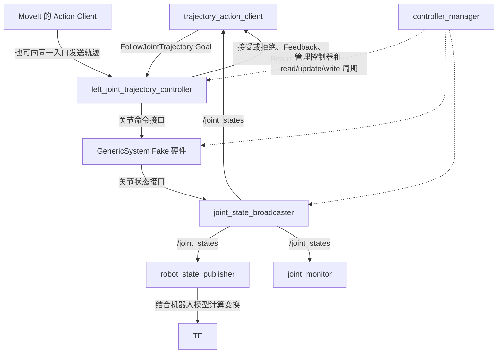

# Stage 3 学习记录：从轨迹请求到关节运动

整理日期：2026-10-15。环境：ROS 2 Jazzy，容器内运行，使用 `mock_components/GenericSystem` Fake 硬件。

这份记录对应我们亲手完成的实验。目标是能读懂、修改、运行和排查客户端，不要求默写整份程序。

## 1. 先把整条链连起来：谁下单，谁执行，谁报告状态？

把一次运动想成一次配送：客户端填写任务单，控制器安排沿途怎么走，硬件接口负责落实并提供状态。任务是否被接受、途中进度、最终结果，是不同的消息。



图中的命令接口、状态接口是 ros2_control 内部接口，不是 ROS Topic。

| 对象 | 本项目名称 | 通俗含义 | 谁使用它 |
|---|---|---|---|
| 学习客户端 | `trajectory_action_client` | 自己填写并发送任务单 | 我们的 Python 程序 |
| Action 入口 | `/left_joint_trajectory_controller/follow_joint_trajectory` | 左臂接收轨迹的入口 | 学习客户端或 MoveIt |
| 轨迹控制器 | `left_joint_trajectory_controller` | 根据轨迹计算运动途中各时刻的指令 | controller_manager 调度 |
| 控制管理器 | `controller_manager` | 管理控制器、硬件和控制循环 | ros2_control |
| MoveIt 客户端 | `/moveit_simple_controller_manager` | 将规划好的轨迹交给控制器 | MoveIt |
| Fake 硬件插件 | `mock_components/GenericSystem` | 提供理想化的命令和状态行为 | ros2_control 硬件层 |
| 状态广播器 | `joint_state_broadcaster` | 将关节状态发布出来 | `/joint_states` 的订阅者 |
| TF 发布节点 | `robot_state_publisher` | 结合关节状态和机器人模型计算坐标变换 | RViz 等工具 |

本次学习客户端直接发送关节轨迹，没有经过 MoveIt 规划。RViz 用来显示机器人；当前 Fake 硬件不是 MuJoCo 或 Gazebo 的动力学仿真。后续接入 MuJoCo 是另一个工作阶段。

## 2. 回到配置：每份文件负责什么？

有了角色分工，再看配置就有了目的：我们要确认硬件提供什么，以及控制器选择使用什么。

| 文件 | 要确认的内容 |
|---|---|
| [demo.launch.py](../third_party/openarm_ros2/openarm_bimanual_moveit_config/launch/demo.launch.py) | 启动参数如何传入机器人描述和控制配置 |
| [双臂 ros2_control Xacro](../third_party/openarm_description/assets/robot/openarm_v2.0/urdf/ros2_control/openarm.bimanual.ros2_control.xacro) | 硬件宏调用、关节命令接口与状态接口 |
| [控制器 YAML](../third_party/openarm_ros2/openarm_bringup/config/controllers/openarm_bimanual_moveit_controllers.yaml) | 左臂关节列表、控制器选择的接口和容差 |
| [学习客户端](../src/openarm_learning/openarm_learning/trajectory_action_client.py) | 构造请求、处理回复和超时 |
| [setup.py](../src/openarm_learning/setup.py) | 将 Python `main` 注册成 `ros2 run` 入口 |
| [package.xml](../src/openarm_learning/package.xml) | 声明依赖 |

Command 像方向盘、油门：写入希望机器人执行的指令。State 像仪表盘：读取当前状态。

```xml
<!-- Xacro：声明关节提供的接口；这是原文件中的核心结构摘录 -->
<command_interface name="position"/>
<command_interface name="velocity"/>
<command_interface name="effort"/>
```

```yaml
# 控制器 YAML：这个轨迹控制器实际选择的位置接口
command_interfaces:
  - position
state_interfaces:
  - position
```

| 字段 | 本次观察值 | 通俗含义 | 背后由谁控制／读取 |
|---|---|---|---|
| position 命令接口 available | `True` | 接口可用 | 硬件生命周期和资源管理 |
| position 命令接口 claimed | `True` | 已被控制器占用来写命令 | 激活的控制器申请接口 |
| position 状态接口 available | `True` | 可以读取位置状态 | 控制器、广播器读取 |
| position 状态接口 claimed | `False` | 状态接口允许共享读取；该值不表示无人读取 | ros2_control 的状态接口管理 |

Xacro 声明接口，控制器配置选择接口，控制器激活后产生实际占用状态。仅声明 `position` 不会自动得到 `claimed=True`。

## 3. 读懂轨迹：七个名字怎样对应七个位置？

控制器知道要控制谁之后，客户端需要把“名字、目标位置、到达时间”填进任务单。

当前正常设置：

- 关节名称为 `openarm_left_joint1` 至 `openarm_left_joint7`。
- 从 `/joint_states` 读取完整七关节位置。
- joint1 在读取值基础上增加 `0.05 rad`，其余六个目标位置保持读取值。
- 一个轨迹点，`time_from_start.sec = 3`。
- 每个客户端进程只发送一次 Goal。

```python
joint_positions = dict(zip(msg.name, msg.position))  # 同下标的名字与位置配对
self.current_positions = [
    joint_positions[name] for name in self.joint_names
]  # 再按左臂七关节的固定顺序排列
```

`trajectory.joint_names[i]` 与 `point.positions[i]` 必须对应同一个关节。`time_from_start` 从轨迹起点计时，不从输入 `ros2 run` 时计时。

`first_sample` 用来保证首次拿到完整状态时才构造并发送任务。后续状态仍可以更新，回调不会因此退出整个程序。没有 Topic 消息时，订阅回调不会自行循环执行。

## 4. 重点复习：三个 Future 和各段期限

Future 像一张等回复的取件单；deadline 像闹钟。取件单回答“回复到了吗”，闹钟回答“已经等太久了吗”。

| 字段 | 初值／后续值 | 通俗含义 | 设置与读取位置 |
|---|---|---|---|
| `send_future` | `None` → Future | 等 Goal 接受或拒绝回复 | `send_goal()` 设置；回复回调、主循环使用 |
| `goal_reply_deadline` | `None` → 发送时刻 + 5 秒 | 等接单回复的上限 | `send_goal()` 设置；主循环检查 |
| `result_future` | `None` → Future | 等任务最终结果 | 接受回调调用 `get_result_async()`；结果回调、主循环使用 |
| `result_deadline` | `None` → 接受回复时刻 + 5 秒 | 正常执行阶段的等待上限 | 接受回调设置；主循环检查，触发取消后置回 `None` |
| `cancel_future` | `None` → Future | 等取消请求本身的回复 | 主循环发送取消时设置；取消回复回调使用 |
| `cancel_result_deadline` | `None` → 发送取消时刻 + 5 秒 | 取消后等最终结果的上限 | 主循环设置、检查 |
| `state_deadline` | 找到服务端后当前时间 + 5 秒 | 等完整关节状态的上限 | `main()` 的局部变量 |
| `done` | `False` → `True` | 客户端本次处理是否结束 | 拒绝、结果或超时分支设置；主循环读取 |
| `goal_handle` | 接受／拒绝回复到达时取得 | 指向这项任务的“订单” | 用来请求结果、请求取消 |

当前 `goal_handle` 在回复回调中首次赋值；其他上述实例属性已在 `__init__()` 初始化。后续整理代码时，可同样提前初始化它，保持风格一致。

最容易混淆的三点：

1. `send_future.done()` 表示接单回复对应的 Future 已完成，不表示运动完成。
2. `cancel_future.done()` 表示取消回复对应的 Future 已完成，不表示任务已经取消完成。
3. `node.done` 是自己的布尔标志，不是 Future 的 `done()` 方法；失败或状态未知退出时也可以为 `True`。

严格来说，Future 也可能因异常而完成。当前学习程序尚未完整处理 `future.result()` 抛出的异常。

### 为什么先检查 `is not None`？

```python
node.result_future is not None       # 已经拿到一个 Future
not node.result_future.done()        # 它还没完成
```

Python 的 `and` 从左到右短路判断。没有 Future 时，不继续调用它的 `done()`。

`result_deadline is not None` 则表示这段计时已启用。超时触发取消后把它设回 `None`，可以防止后续每一轮循环重复发送取消请求。

### 为什么用 `monotonic()`？

```python
self.result_deadline = monotonic() + 5.0  # 记录未来的截止时间
```

它用于测量经过的时间；不会因为用户调整日历时间而倒退。到期比较发生在主循环中，因此日志通常是约 5 秒，不保证恰好 5.000 秒。这里采用经过时间，不是仿真时钟。

## 5. 串起回调：登记方法不等于马上执行

现在知道每份回复由哪个 Future 等待，再看回调就是“回复到了，交给谁处理”。

| 回调 | 什么时候执行 | 主要工作 |
|---|---|---|
| `joint_state_callback` | `/joint_states` 消息被处理时 | 读取七关节，首次齐全后发送一次轨迹 |
| `goal_response_callback` | Goal 回复对应 Future 完成时 | 判断接受／拒绝，接受后请求最终结果 |
| `feedback_callback` | Action 过程反馈被处理时 | 打印当前期望、实际位置和误差 |
| `cancel_response_callback` | 取消回复对应 Future 完成时 | 打印 `return_code` 和 `goals_canceling` 数量 |
| `result_callback` | 最终结果对应 Future 完成时 | 判断成功、取消或失败，设置 `done=True` |

```python
node.cancel_future.add_done_callback(node.cancel_response_callback)
```

外层 `add_done_callback(...)` 立即登记方法；里面的方法不加括号，交给 Future 在适当时机调用。回调机制会把完成的 Future 作为参数传入。

`node.cancel_response_callback` 是绑定方法，同时记住方法和 `node` 对象。它类似 C++ 中捕获对象的回调；调用时 Python 自动提供 `self`。

登记回调不创建子进程，也不等待取消回复。当前程序通过 `spin_once()` 让执行器处理消息和回调，再继续检查超时：

```python
while rclpy.ok() and not node.done:
    rclpy.spin_once(node, timeout_sec=0.1)
    # 然后检查当前阶段是否超时
```

`rclpy.ok()` 检查本进程 ROS context 是否仍有效，不检查控制器健康或任务成功。`timeout_sec=0.1` 限制等候可处理工作的时间，不限制回调自身执行时长；耗时回调会延迟超时检查。

## 6. 根据结果分流：拒绝、成功、取消、失败

接单回复只回答“接不接”。接受之后，Feedback 报告途中情况，Result 报告结局。

| 情况 | 客户端证据 | 处理位置 |
|---|---|---|
| 被拒绝 | `goal_handle.accepted == False` | `goal_response_callback()` |
| 成功 | 状态 `4`，轨迹错误码 `0` | `result_callback()` |
| 已取消 | 状态 `5` | `result_callback()` |
| 执行中终止 | 状态 `6`，结合错误码和说明排查 | `result_callback()` |
| 等待超时、结局未知 | 没取得相应回复或最终结果 | 主循环 |

取消回复的 `return_code=0` 表示取消请求被接受；`goals_canceling` 长度为 1 表示一个任务进入取消流程。最终状态 `5` 才是任务以取消结束的结果。

轨迹结果的 `error_code` 是另一个字段。我们实际见过取消结果携带 `error_code=0`，因此不能只看这个数字判断成功。

| Feedback 字段 | 通俗含义 |
|---|---|
| `desired.positions` | 轨迹要求这个时刻应该到的位置 |
| `actual.positions` | 控制器读取到的当前位置；本次来自 Fake 硬件 |
| `error.positions` | 控制器给出的跟踪误差 |

`0.0000` 只表示打印四位小数后的数值，不能证明误差严格为零。`throttle_duration_sec=0.5` 限制日志打印频率，不代表控制器只每半秒更新一次。

## 7. 保存证据：我们已经跑过哪些实验？

有了上述判断位置，下面每条日志都能对应到具体路径。日志摘录来自学习过程，省略时间戳；模拟测试与实际控制器实验分开标明。

| 实验 | 方法 | 已观察结果 |
|---|---|---|
| 正常执行 | 七关节正确，joint1 增加 0.05 rad，3 秒到达 | 状态 4、错误码 0、成功退出 |
| 初始状态缺失 | 把 `/joint_states` 重映射到不存在的 Topic | 约 5 秒后超时，不发送 Goal |
| 接单回复缺失（模拟） | patch `send_goal_async()` 返回未完成 Future | 不发送真实 Goal，约 5 秒后状态未知退出 |
| 主动取消 | 曾设 10 秒轨迹，接受后 2 秒请求取消 | 取消回复码 0、任务数 1、最终状态 5 |
| 执行结果等待超时 | 10 秒轨迹，结果等待上限 5 秒 | 约 5 秒请求取消，收到状态 5 后退出 |
| 取消后结果缺失（模拟） | patch `get_result_async()` 返回未完成 Future | 向 Fake 控制器发送任务和取消；两段各约 5 秒后状态未知退出 |
| Goal 被拒绝 | 仅将轨迹请求中的 joint1 名字改为 `learning_invalid_joint` | 明确拒绝，客户端退出 |
| 失败结果处理（模拟） | 手动构造状态 6、错误码 -4，调用结果回调 | 打印失败，`done=True`；未发送任务 |
| 实际路径容差失败 | 对 joint1 设置 `path_tolerance.position=1e-9` | Goal 接受后，状态 6、错误码 -4 |
| 最终恢复验证 | 移除极小容差要求，恢复 3 秒正常轨迹 | 编译成功，约 3 秒后状态 4、错误码 0 |

### 实际拒绝日志：请求没有被接下

```text
轨迹关节：['learning_invalid_joint', 'openarm_left_joint2', 'openarm_left_joint3', 'openarm_left_joint4', 'openarm_left_joint5', 'openarm_left_joint6', 'openarm_left_joint7']
发送 Goal，等待接受或拒绝回复（最多5秒）
Goal 被拒绝
任务处理结束，客户端退出
```

### 实际执行失败日志：接下后检查出问题

```text
路径位置容差：openarm_left_joint1=1e-09 rad
Goal 已接受
等待执行结果（最多5秒）
最终状态：6
轨迹错误码：-4
轨迹说明：'Aborted due to path tolerance violation'
任务未成功，请检查最终状态和轨迹说明
任务处理结束，客户端退出
```

路径位置容差要求运动途中实际位置与当前期望位置的偏差在允许范围内。`-4` 是 `PATH_TOLERANCE_VIOLATED`；本实验的极小正数只是故意触发故障的条件，已移除。容差字段的 `0` 表示沿用默认设置，不是要求零误差。

### 最后一次正常恢复日志

```text
openarm_left_joint1=0.2748 rad
目标位置：array('d', [0.32481348471166666, 0.0, 0.0, 0.0, 0.0, 0.0, 0.0])
到达时间：3 秒
Goal 已接受
等待执行结果（最多5秒）
最终状态：4
轨迹错误码：0
轨迹说明：'Goal successfully reached!'
执行成功
任务处理结束，客户端退出
```

从接受回复 `1792052317.625254638` 到最终结果 `1792052320.626245107`，约 3.001 秒。日志中的当前位置保留四位小数，内部计算使用完整精度。

## 8. 下次从这里启动：完整运行步骤

实验已经恢复正常配置。以下命令在 ROS 容器内的 Bash 终端执行；如果演示已经运行，不重复启动第二套。

终端 1：启动 Fake 演示。

```bash
cd /home/ashenlad/code/openarm-custom-stack
source /opt/ros/jazzy/setup.bash
source install/setup.bash
ros2 launch openarm_bimanual_moveit_config demo.launch.py \
  arm_type:=openarm_v2.0 \
  use_fake_hardware:=true \
  robot_controller:=joint_trajectory_controller \
  launch_rviz:=true
```

终端 2：编辑保存后，编译、刷新、运行。

```bash
cd /home/ashenlad/code/openarm-custom-stack
source /opt/ros/jazzy/setup.bash
colcon build --packages-select openarm_learning --symlink-install
source install/setup.bash
ros2 run openarm_learning trajectory_action_client
```

这是 `ament_python` 包，入口已在 `setup.py` 注册为：

```python
'trajectory_action_client = openarm_learning.trajectory_action_client:main'
```

依赖已在 `package.xml` 声明，包括 `rclpy`、`sensor_msgs`、`trajectory_msgs`、`control_msgs`、`action_msgs`。本程序不需要额外添加 CMake 编译规则。曾遇到的入口 `StopIteration` 问题，在重新构建包、刷新环境后解决。

需要查现场时，在已刷新环境的终端执行：

```bash
ros2 action info /left_joint_trajectory_controller/follow_joint_trajectory
ros2 topic info /joint_states --verbose
ros2 service call /controller_manager/list_controllers controller_manager_msgs/srv/ListControllers '{}'
ros2 service call /controller_manager/list_hardware_interfaces controller_manager_msgs/srv/ListHardwareInterfaces '{}'
ros2 service call /controller_manager/list_hardware_components controller_manager_msgs/srv/ListHardwareComponents '{}'
```

这些命令分别确认 Action 连接、状态发布订阅关系、控制器状态、接口使用情况和实际硬件插件。早期环境没有 `ros2 control` 子命令，以上 service 调用提供了直接检查路径。订阅者数量随运行的节点变化，以现场为准。

## 9. 记录边界，明确后续方向

现在程序覆盖了本阶段的常用路径。复习时也要知道这些实验验证到哪里：

- 当前是 Fake 硬件。关节运动、反馈和错误处理链路已验证，动力学、接触和真实电机行为尚未验证。
- 直接发送轨迹没有经过 MoveIt 的碰撞规划。当前代码也没有完整的目标限位检查；不要用反复增加位移来测试故障。
- 每次运行 joint1 目标都在当前值上增加 0.05 rad，重复运行会累积。此前 `+10 rad` 的试验曾观察到限位位置，不应重复这种方式。
- 客户端退出不等于机器人停止；`Ctrl+C` 的当前处理也没有主动等待取消完成。状态未知时不自动重发。
- 当前异常处理和进程退出码还未完善；打印失败后，shell 退出码不一定反映任务失败。
- 取消回复与最终结果异步到达，日志先后不是通用保证；当前程序以最终结果结束任务处理。
- 当前参数是教学用的固定值。以后可把运动增量、轨迹时间和各等待上限改成 ROS 参数。

后续先做一次整体复盘，再决定参数化、代码整理或 MuJoCo 接入。复盘时沿着这一条主线讲清楚即可：

**读取当前状态 → 构造轨迹 → 发送 Goal → 判断接受／拒绝 → 观察反馈 → 接收结果；等不到消息时，按阶段超时处理。**

教学继续采用：先解释用途与直觉，每次一个小闭环，说明代码改在哪里，给出完整运行步骤，再用实际日志验证。无需背完所有 API。
